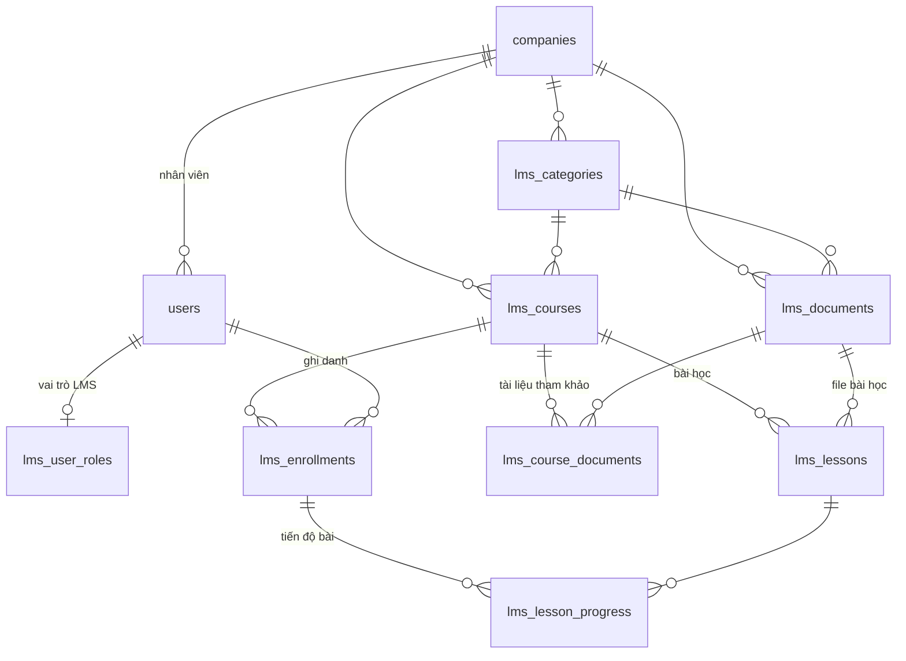

# Thiết kế Database – LMS doanh nghiệp

PostgreSQL 16 · **dùng chung database `project_manager`** (user `pm_user`) · Migration: Alembic (`backend/migrations/`,
bảng phiên bản riêng `alembic_version_lms`) · Schema: `backend/migrations/sql/0001_lms_schema.sql`

## 1. Phân chia giữa hai hệ thống

| Thuộc | Bảng | Ghi chú |
|---|---|---|
| project_manager (revision **0008**) | `companies` | Doanh nghiệp; `code` = mã công ty khi đăng nhập (citext, duy nhất giữa công ty chưa xoá) |
| | `users` + cột `company_id`, `employee_code` | Nhân viên = tài khoản dùng chung với Project Manager (cùng mật khẩu). Mã nhân viên duy nhất trong công ty; `UNIQUE (company_id, id)` cho FK kép của LMS |
| | `activity_logs` | Audit dùng chung; LMS ghi thêm `lms_login` / `lms_login_failed` |
| lms_mcv (revision 0001) | `lms_*` | Bảng dưới đây |

Thứ tự migration: project_manager `alembic upgrade head` (≥ 0008) → LMS `alembic upgrade head`.
Migration LMS tự kiểm tra và báo lỗi nếu project_manager chưa tới 0008.

## 2. Sơ đồ quan hệ

## 3. Danh sách bảng LMS

| Bảng | Mục đích |
|---|---|
| `lms_user_roles` | Vai trò LMS: `admin` (quản trị LMS công ty), `instructor` (soạn nội dung, giao khoá học). Không có dòng = `learner` |
| `lms_categories` | Danh mục cho khoá học và tài liệu, tên duy nhất trong công ty |
| `lms_documents` | Thư viện tài liệu, file trên Cloudflare R2 (`storage_key`). `visibility`: `company` (mọi nhân viên) / `course` (chỉ học viên khoá học có dùng). Xoá mềm |
| `lms_courses` | Khoá học: `code` duy nhất trong công ty, `status` draft → published ↔ archived, `enroll_mode` `open` (tự đăng ký) / `assigned` (chỉ người được giao). Xoá mềm |
| `lms_lessons` | Bài học: `content_type` text / video (file hoặc link) / document / link; `sort_order`; `is_required` |
| `lms_course_documents` | Tài liệu tham khảo của khoá học |
| `lms_enrollments` | Ghi danh: `source` assigned/self, `due_date`, `status` not_started → in_progress → completed, `progress_percent` |
| `lms_lesson_progress` | Tiến độ từng bài: `last_position_seconds` (video), `completed_at` |

## 4. Toàn vẹn dữ liệu

- **Tách dữ liệu theo công ty**: mọi bảng có `company_id`; FK kép `(company_id, course_id)`, `(company_id, document_id)`,
  `(company_id, category_id)`, `(company_id, user_id) → users(company_id, id)` đảm bảo khoá học / tài liệu / nhân viên
  không gắn nhầm công ty khác. Tiến độ bài dùng `(enrollment_id, course_id)` + `(course_id, lesson_id)` để bài học
  chắc chắn thuộc khoá học của ghi danh.
- Chuyển nhân viên sang công ty khác bị chặn khi còn ghi danh (API "gỡ nhân viên" xoá ghi danh trước).
- **Tiến độ**: % bài bắt buộc đã hoàn thành (khoá không có bài bắt buộc thì tính mọi bài); tính lại khi học viên học
  bài, khi thêm / xoá bài hoặc đổi `is_required`. Ghi danh đã `completed` giữ nguyên kể cả khi khoá học thêm bài.
- **Audit**: trigger `fn_audit_log()` của project_manager trên `lms_user_roles`, `lms_categories`, `lms_documents`,
  `lms_courses`, `lms_lessons`, `lms_enrollments` (không audit `lms_lesson_progress` vì ghi rất thường xuyên).
  `updated_at` tự cập nhật bằng `fn_set_updated_at()`.

## 5. Hướng mở rộng

- Bài kiểm tra / câu hỏi trắc nghiệm (`lms_quizzes`, `lms_questions`, `lms_quiz_attempts`), điểm đạt để hoàn thành khoá.
- Chứng chỉ hoàn thành (`lms_certificates`), lộ trình học (`lms_learning_paths`).
- Phòng ban / chức danh để giao khoá học theo nhóm.
